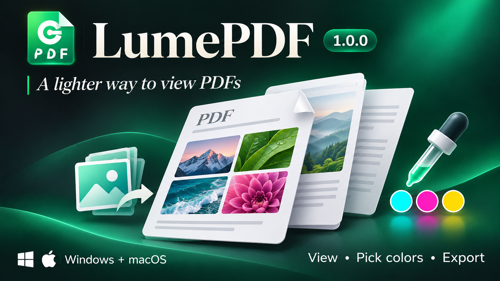

# LumePDF 1.0.0

A lightweight desktop PDF viewer for browsing documents, checking colors and exporting pages as images.

Developed by **Huy cola**. Contact: **huypx92@gmail.com**.

## Downloads

- [LumePDF-1.0.0.zip](LumePDF-1.0.0.zip) — complete Windows and macOS package with an additional bilingual start guide. Open the file page and choose **Download raw file**.
- [LumePDF_Package_Staging.rar](LumePDF_Package_Staging.rar) — the original package, preserved unchanged.
- [START_HERE.txt](START_HERE.txt) — installation requirements and package notes.
- [SHA256SUMS.txt](SHA256SUMS.txt) — checksums for both archives.

Or download for free from [Gumroad](https://huypx.gumroad.com/l/lumepdf).

The Gumroad download is free ($0). The complete supplied package is also available in this public repository.

## Features

- PDF viewing powered by PDFium.
- Folder cover gallery and page thumbnail sidebar.
- Multiple document tabs, zoom, fit width, fit page and 90-degree view rotation.
- Color picker with RGB/HEX and approximate CMYK information.
- Export individual pages to JPG or PNG and copy a page image to the clipboard.
- Interface languages: Vietnamese, English, Chinese, Japanese, Korean, French, Spanish and Russian.
- Windows installers for x64 and x86; macOS source-based installation for Apple Silicon and Intel.

## Installation

**Windows:** extract the archive and run the appropriate installer in `window`. The x64 installer is the recommended choice for most current Windows 10/11 computers. Original Vietnamese instructions are included.

**macOS:** the supplied app bundle includes source code and PDFium libraries for both architectures. The first installation builds a native executable on the Mac. Internet access and Xcode Command Line Tools are required; the installer downloads Rust with rustup when Cargo is unavailable. Read the supplied script before running it: it replaces `/Applications/LumePDF.app` and clears the installed app's extended attributes. This release preparation did not include a macOS runtime test.

## Scope and color preview

LumePDF is presented as a PDF viewer with image export. PDF text editing, OCR, document merging and digital signing are not advertised. CMYK preview is an approximation and does not guarantee a match to a physical print.

## Tiếng Việt

LumePDF là phần mềm xem PDF, duyệt thư viện ảnh bìa, soi màu và xuất từng trang thành ảnh JPG/PNG. Gói tải gồm bộ cài Windows 32-bit/64-bit và bản macOS biên dịch từ mã nguồn trong lần cài đầu. Bản macOS cần Internet và công cụ biên dịch. Xem `START_HERE.txt` và hướng dẫn gốc trong gói để cài đặt.

## Package provenance

The original installers and application source were supplied in `LumePDF_Package_Staging`. Application code and installers were not modified while preparing these distribution assets. No new open-source license is granted by this repository; third-party components remain subject to their respective licenses.
